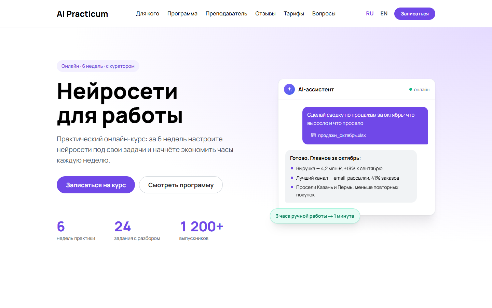
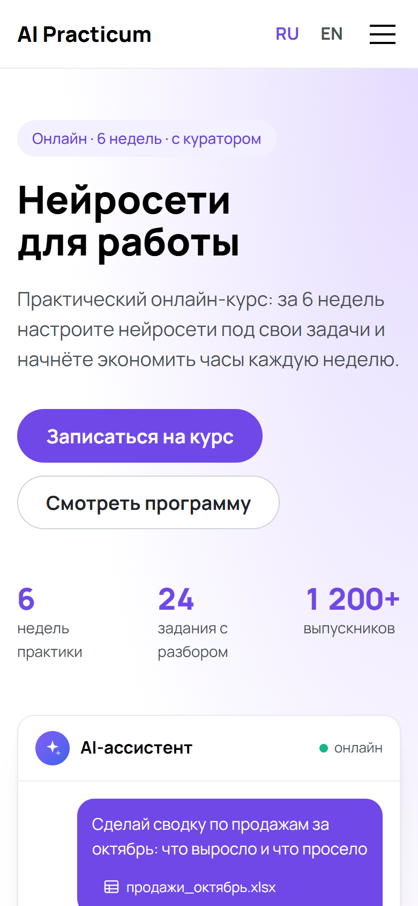
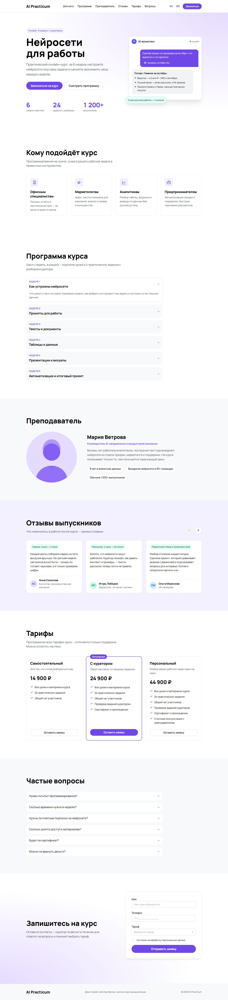

# AI Practicum — демо-лендинг онлайн-школы

[](https://github.com/Jek-Konservator/DemonstrationLanding/actions/workflows/ci.yml)

> Демо-проект для портфолио. Школа и курс вымышленные.

Лендинг онлайн-курса «Нейросети для работы» на двух языках (ru / en).

**Демо:** https://demonstration-landing.vercel.app

<p>
  
  
</p>

<details>
<summary>Вся страница целиком</summary>



</details>

## Что внутри

- Секции: первый экран с иллюстрацией-чатом, «Для кого», программа (аккордеон), преподаватель, отзывы со слайдером, тарифы, FAQ, форма заявки.
- Форма заявки: валидация, маска телефона, выбор тарифа кнопкой в «Тарифах», отправка в Telegram через `/api/lead`, защита от ботов (honeypot). Без ключей бота — демо-режим: заявка проверяется, но никуда не уходит.
- Два языка с отдельными адресами `/ru` и `/en`, переключатель в шапке.
- SEO: canonical, hreflang, Open Graph, OG-картинка для каждого языка, sitemap, robots, JSON-LD курса.
- Микровзаимодействия: появление секций при скролле, подъём карточек, тень шапки, счёт цифр.
- Адаптивная вёрстка mobile-first, доступность: семантика, контраст, управление с клавиатуры.

## Lighthouse

Мобильный / десктоп, прод на Vercel:

| Performance | Accessibility | Best Practices | SEO |
| ----------- | ------------- | -------------- | --- |
| 94 / 99     | 100 / 100     | 100 / 100      | 100 |

First Load JS главной — 150 kB.

## Стек

- Next.js (App Router), React, TypeScript
- Mantine через собственный UI Kit, SCSS-модули
- next-intl — мультиязычность
- effector + farfetched — состояние и отправка формы
- react-hook-form + yup — форма заявки
- Vitest + Testing Library — тесты, покрытие 100%
- ESLint, Prettier, Stylelint, Husky, lint-staged, GitHub Actions

## Запуск

Нужен Node 22 (см. `.nvmrc`).

```bash
npm install
cp .env.example .env.local
npm run dev
```

Сайт откроется на http://localhost:3000.

## Переменные окружения

| Переменная             | Что это                                                                |
| ---------------------- | ---------------------------------------------------------------------- |
| `NEXT_PUBLIC_SITE_URL` | Публичный адрес сайта (canonical, sitemap, OG). Без него сборка падает |
| `TELEGRAM_BOT_TOKEN`   | Токен бота для заявок. Пусто — демо-режим                              |
| `TELEGRAM_CHAT_ID`     | Чат, куда бот пишет заявки. Задаётся вместе с токеном                  |

## Скрипты

| Команда          | Что делает                                        |
| ---------------- | ------------------------------------------------- |
| `npm run dev`    | Режим разработки                                  |
| `npm run build`  | Продакшен-сборка                                  |
| `npm run check`  | Форматирование, линтеры, типы и тесты — всё сразу |
| `npm run test`   | Тесты с покрытием                                 |
| `npm run format` | Отформатировать код                               |

## Архитектура

```
src/
├── app/         # роутинг: layout, page, metadata
├── screens/     # экран главной страницы и его секции
├── features/    # шапка, подвал, навигация
├── entities/    # сущности: заявка
├── services/    # HTTP-клиенты
└── shared/      # UI Kit, форма, хуки, константы, конфиги
```

Импорты между слоями проверяются линтером.

## Деплой

Vercel, Git-интеграция: `main` — прод, остальные ветки и пул-реквесты — превью. В настройках проекта нужна переменная `NEXT_PUBLIC_SITE_URL`, ключи Telegram — по желанию.
